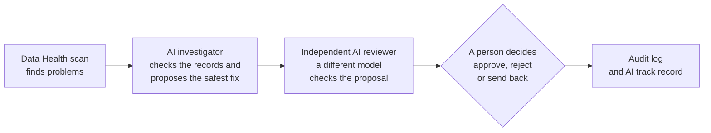

# MissionControl AI

**AI agents that find, fix and double-check a nonprofit's data problems, with a person always making the final call.** Built for the Vultr Agent Rush hackathon (Challenge 2: Powering the Future of Work) and running entirely on Vultr.

**Live demo:** https://64-177-121-249.sslip.io (choose **Try as analyst** or **Try as reviewer**, no sign-up needed)
**Demo video:** link added at submission

All data in the demo is fictional: 2,000 made-up clients across six programs. The demo is shared and is reset before judging.

## The problem

Nonprofits report to funders on outcomes such as people served, jobs found and stable housing. Those reports depend on case records entered by busy staff, and the records are full of small errors: exit dates before entry dates, missing exits, impossible wages, duplicate clients. Finding and fixing them takes hours, and a wrong number in a funder report can cost trust and funding.

MissionControl gives a nonprofit team AI colleagues that do the legwork (finding problems, checking the records, proposing safe fixes, drafting reports) while every change still goes through a person, and every step is recorded.

## How it works



1. **One-click AI health check** (Data Health). The app scans the data for problems, then works through up to five open findings, one of each kind first. For each one, an **AI investigator** reads the records with read-only queries and proposes the safest fix: a follow-up flag whenever the database cannot confirm the correct value, never a guessed number.
2. **Independent AI review.** A second AI agent on a **different model family** checks each proposal against the data, without seeing the investigator's reasoning, and gives a verdict (agree, disagree or unsure), a confidence and specific concerns. It can only advise.
3. **People decide.** Reviewers approve, reject or send back each proposal. Nothing in the source data changes without a human approval, and approvals are recorded under the reviewer's name.
4. **AI reviewer track record** (Approvals & Audit). Every decision records what the AI reviewer had said, so the team can see how often people follow the AI and when they overrule it.
5. **Ask MissionControl.** An AI analyst answers questions about the data ("How did employment outcomes compare for clients who also received housing support?") using bounded tools, cites the steps behind every number, and shows its full investigation trail.
6. **Funder report** (Program Performance). The AI drafts a funder update around the app's verified figures. Every number in the text is checked against those figures, every required section must be present, and a person reviews the draft before sending.

## How the agents do real work, safely

- **Real tools, not descriptions.** The agents call application tools: schema inspection, read-only SQL, metric calculations and proposal creation. Each run's tool calls, arguments, results and timings are stored and shown as an evidence trail.
- **Two layers of read-only protection.** AI-written SQL is parsed and checked against an allowlist (one `SELECT`, approved tables and functions only), then runs under a separate read-only database account with a 3-second time limit and a 200-row cap.
- **Bounded runs.** At most 6 model calls, 12 tool steps and 150 seconds per run. On the last turn an agent is told to finish (write the answer, submit the review or make the proposal), so runs end with a result rather than running out.
- **Proposals, not changes.** Agents can only create pending proposals with exact before and after values. Approval happens in the backend, in one transaction with the audit event, and fails safely if the record changed in the meantime. An author can never approve their own proposal.
- **Verified numbers.** Metrics come from fixed, tested queries. The funder report flags any number the AI did not take from the verified figures.
- **Cost controls.** A daily AI token cap and per-visitor rate limits protect the public demo. Demo mode uses rule-based agents at no AI cost.

## Built on Vultr

| Vultr service | How MissionControl uses it |
|---|---|
| **Vultr Cloud Compute** (Chicago, 2 vCPU / 4 GB, Ubuntu 24.04) | The central backend for the whole workflow: web app, API, AI agents, approval workflow, audit log and PostgreSQL database, run with Docker Compose behind a firewall that only opens SSH, HTTP and HTTPS |
| **Vultr Serverless Inference** (OpenAI-compatible API) | Powers every live AI agent: `deepseek-v4.1-flash-1017` for the analyst, the investigator and the funder report, and `glm-5.3` for the independent reviewer, so the second opinion really comes from a different model |

```
Internet ──HTTPS──▶ Caddy (automatic certificate)
                     └─▶ Nginx: React app + /api proxy            (private)
                          └─▶ FastAPI: agents, approvals, audit   (private)
                               ├─▶ PostgreSQL 16                  (private; separate owner, app and read-only roles)
                               └─▶ Vultr Serverless Inference     (api.vultrinference.com)
```

The inference endpoint, model names and key are settings in the server's `.env`, and the key never reaches the browser. Deployment guide: [docs/DEPLOY_VULTR.md](docs/DEPLOY_VULTR.md).

## A three-minute tour for judges

1. **Data Health** (Try as analyst): click **Run health check** and watch the AI investigator and reviewer work through five different kinds of problem, live.
2. **Approvals & Audit** (Try as reviewer): open a proposal, read the AI reviewer's verdict and concerns, then approve, reject or send it back. The **AI reviewer track record** updates.
3. **Ask MissionControl**: ask *"How did employment outcomes compare for clients who also received housing support?"* and open the investigation trail.
4. **Program Performance**: click **Draft funder report** and look at the number check.

## Project history: what was built before and during the event

This project started before the hackathon. So judges can see exactly what is new, here is what existed before the online build began on 3 November 2026. The full commit history is kept intact so judges can verify it.

**Before 3 November 2026** (commits from 6 October to 2 November):
- The base application: dashboard, metrics, Data Health checks on fictional data, correction and merge proposals with human approval, the audit log, and a demo/live analyst agent with read-only SQL tools.
- Phase 1 (16 October): personal reviewer identities, send back for reevaluation, proposal provenance, saved failed runs, database migrations.
- Phase 2 (24 October): an independent AI reviewer agent and an approval queue that shows AI disagreements first.
- Non-AI preparation (26 October onwards): query performance, browser sessions and a public demo mode, rate limits and an AI budget cap, a demo data reset command, review shortcuts and links, and Vultr deployment scaffolding.
- Development tooling and AI reliability (27 October): automated GitHub checks on every pull request (linting, backend tests on SQLite and PostgreSQL, frontend build), retries and a 150-second time limit for AI provider requests, and the AI agents' instructions moved into readable files (`agent/prompts/`). Missed fixes from 26 October (a migration repair for older databases and a backend image permission fix) were also merged on 30 October.
- Final pre-event polish (30 October – 2 November): an MIT license, repository tidy-up, and a redesigned Ask page (question box first, with the reporting period and key figures in the right-hand column).

**During the event (3–8 November 2026):**
- 3 November: deployed MissionControl on a Vultr Cloud Compute instance (Chicago) with public HTTPS, and switched on live AI through Vultr Serverless Inference: `deepseek-v4.1-flash-1017` for the analyst and `glm-5.3` for the independent reviewer, so the second opinion comes from a different model family.
- 4 November: fixes found while testing on Vultr. The analyst is now asked for a written answer, without tools, when it runs out of turns or replies blank (#8), and the reviewer is asked to submit its review on its last turn (#9).
- 5 November: one-click AI health check on Data Health. An AI investigator (`agent/investigator.py`) takes one open finding at a time, one of each kind first, checks the records and proposes the safest fix: a follow-up flag unless the database confirms the exact value. The independent AI reviewer then checks each proposal, and the page shows live progress, the proposed fix and the reviewer's verdict. Nothing changes until a person approves it (#11, #12, #13).
- 5 November (continued): AI reviewer track record on Approvals & Audit, showing how often people follow or overrule the independent AI reviewer, from the verdict recorded with each decision (#15, shown in a side column since #17). Also fixed the SQL safety check, which had been rejecting AND, OR and EXISTS and so limiting what the AI agents could check (#16).
- 5 November (later): AI answers are now formatted with headings, lists and tables, without ever rendering raw HTML from the model (#19). New funder report on Program Performance: verified figures from the app's own metrics, data-quality notes from Data Health, and a narrative written by the AI, with every number checked against the verified figures and every section required before the draft gets a green check; a person reviews it before sending (#20, #21, #22).
- 5 November(evening): this README, rewritten for judges.

## Run it yourself

- **On Vultr:** [docs/DEPLOY_VULTR.md](docs/DEPLOY_VULTR.md). A fresh Ubuntu 24.04 instance plus `bash scripts/vultr-setup.sh` installs Docker and the firewall, generates credentials and starts everything with HTTPS.
- **In GitHub Codespaces** (browser only): [docs/SETUP.md](docs/SETUP.md), then `bash scripts/cloud-start.sh`.
- **On your own computer:** [docs/LOCAL_SETUP.md](docs/LOCAL_SETUP.md).

No AI key is needed for the guided demo (`AGENT_MODE=demo`). For live AI, set `AGENT_MODE=live`, `LLM_BASE_URL=https://api.vultrinference.com/v1`, `LLM_MODEL`, `LLM_REVIEW_MODEL` and `LLM_API_KEY` in `.env`.

## Repository layout

| Folder | Purpose |
|---|---|
| `frontend/` | React and TypeScript dashboard (Vite) |
| `backend/` | FastAPI routes, data model, approvals, limits and the AI track record |
| `agent/` | The AI agents (analyst, investigator, reviewer, funder report), the shared tool loop, the SQL safety check, and their instructions in `agent/prompts/` |
| `database/` | Fictional seed data, migrations and role grants |
| `docker/`, `deploy/` | Images, Nginx, PostgreSQL roles and the Caddy HTTPS front door |
| `scripts/` | Credential setup, Codespaces start-up and Vultr setup |
| `tests/` | Backend tests: workflows, permissions, SQL safety, agents with a mocked AI |
| `docs/` | Setup, deployment, architecture, costs, demo script and roadmap |

More detail: [docs/ARCHITECTURE.md](docs/ARCHITECTURE.md).

## Tests and checks

Every pull request runs three automated checks on GitHub: linting plus about 160 backend tests on SQLite, the full backend test suite on PostgreSQL 16 with the real read-only and application database roles, and the frontend build. Changes reach `main` only through pull requests that pass them.

## Built with AI assistance

Development used Claude Code, an AI coding assistant. Commits it authored are marked with its name in the history; later changes were made by the author through pull requests.

## License

MIT. See [LICENSE](LICENSE).